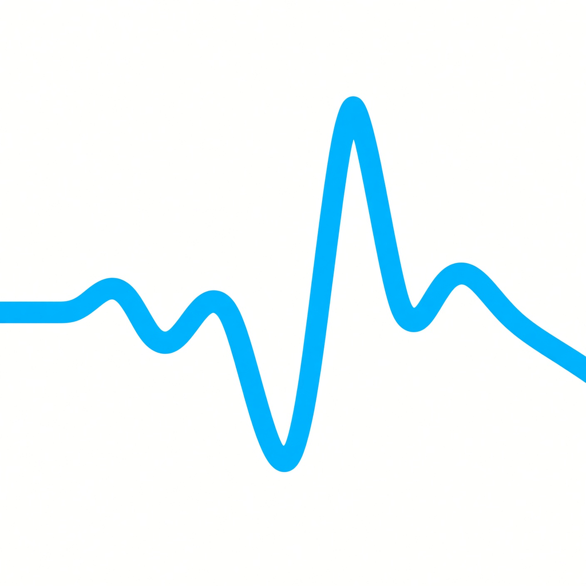

# NeuroFeed

[](https://sonarcloud.io/project/overview?id=windwerfer_neurofeed) [](https://sonarcloud.io/project/overview?id=windwerfer_neurofeed) [](https://github.com/windwerfer/neurofeed/actions/workflows/codeql.yml)

<p align="center">
  <a href="https://getartcraft.com/">
    <picture>
      <source media="(prefers-color-scheme: dark)" srcset="assets/neurofeed_icon.png">
      
    </picture>
  </a>
</p>

## Notice

the app is porting from Flutter + Rust to pure Rust at the moment, the whole UI is just preliminary at the moment.
it will take me a while to bring it back to how it behaved. If you would like to try the old more polished UI, use [release 0.60.0](https://github.com/windwerfer/neurofeed/releases/tag/0.60.0).
  
(Why? mixing Flutter and Rust is possible but makes the development process unnecessarily complicated. I saw the software design of PhotoCraft, and there way to build for AI coding is just superior. Its an experiment so far, but it seems like a viable path.)

# About the App

EEG brainwave viewer and feedback. At the moment we support Muse 2, Muse S, Muse Athena
and the Neurosity Crown as input devices. 

- Bands Monitor
- Raw EEG
- Historgram
- Spectogram
- Feedback System is beeing worked on (using freely available, labeled EEG data, we try to find
  feedback presets that helps train you mind)
- Record your Brainwaves and export them to EDF+ or CSV
- Import from EDF data or MindMonitors CVS

This is a pure Rust implementation, making it natively on Windows, Linux, Mac and Android, or on every system with
chrome support through WEB Assembly.

The Project is structurally heavily inspired by PhotoCraft's approach to make AI agents able to use the programm through 
a headless core (`nf-core`), an MCP server and exposing every command (`nf-mcp`) through cli. Signal processing (`nf-dsp`), recording
formats NFED6/EDF+ (`nf-format`), deterministic raw-sample device simulators
(`nf-sim`), and an egui/eframe UI for desktop and web (Android later).


# how to run

Check out the release page if you just want to use it. If you want to help with improving or want to compile it yourself, i recommend using
the development container. you only need rust installed for the desktop version, for android builds you need the whole android toolchain (scripts for
easy setup are in the .devcontainer subfolder). I use Zed as my editing IDE and podman, so expect small glitches with VS Code and docker. 


```sh
# prerequisites: rustup target add wasm32-unknown-unknown; cargo install trunk
# Linux: apt install pkg-config libasound2-dev libdbus-1-dev
#   (Fedora: alsa-lib-devel dbus-devel); ALSA = feedback audio (skip with
#   --no-default-features), D-Bus = Bluetooth (BlueZ) for the Muse
cargo run --release -p neurofeed-egui                       # desktop (repo root)
cd apps/neurofeed-egui && trunk serve --release             # web, http://127.0.0.1:8080
cargo run --release -p neurofeed-cli --bin neurofeed-cli -- run status  # one command, headless
NF_BRIDGE=1 cargo run --release -p neurofeed-egui           # desktop + agent bridge, then:
target/release/neurofeed-cli --bridge mcp                   # MCP driving the live app
cargo test && cargo clippy --all-targets -- -D warnings
```

Real devices (desktop): the Device dialog scans for a Muse over Bluetooth and
a Crown streaming OSC to UDP 9000 for as long as it is open (Neurosity app /
SDK OSC output), then Connect. MCP: `device.dialog`, `device.list`,
`device.connect`. `device.scan {seconds}` is a timed scan. The web build has
simulators only.

Agent bridge: with `NF_BRIDGE=1` or Settings > About > Agents, the app listens on
127.0.0.1 (random port) and writes the port + a random token to
`~/.local/share/neurofeed/bridge.json` (0600; macOS `~/Library/Application
Support/NeuroFeed`, Windows `%APPDATA%\NeuroFeed`, or `NF_BRIDGE_FILE`).
`neurofeed-cli --bridge` then drives the running app with the same tools plus
`screenshot` and `ui_inspect` (widget tree). CLI, JSON lines, MCP and client setup: [docs/automation.md](docs/automation.md).

Read [AGENTS.md](AGENTS.md), then [docs/](docs/).

### Importing recordings

History → **Import…** (or drop a file on the window) accepts EDF/EDF+, Mind Monitor CSV (constant or interval mode), `.neurofeed` and raw NFEDBIN. A preview lists what is kept and what is lost before anything is saved. MCP: `history.import_preview` / `history.import` with `{file_name, data_base64}`.

### Protocol Builder

Feedback → "New protocol…" (starts from the selected protocol) or "Edit …" on a custom one. Set the title, reward feature, eyes, length, up to two band ceilings (beta, delta) and whether the drowsiness guard is offered (still off until switched on). The card preview and problems update as you type. Custom protocols are saved with history (SQLite on desktop, localStorage in the browser). MCP: `protocol.validate`, `protocol.draft`, `protocol.save`, `protocol.delete`.

### Streaming (OSC)

Streaming → enable, set IP/port/prefix. Messages `<prefix>/eeg|ppg|imu|bands` with `[t, values…]` float32. MCP: `streaming.set`, `streaming.status`. Desktop only (browsers cannot send UDP). LSL is not available yet.

## Security

[SonarQube Cloud](https://sonarcloud.io/project/overview?id=windwerfer_neurofeed) CI analysis (`.github/workflows/sonarcloud.yml`) runs on every push to `main` and on pull requests, with Clippy and coverage imported. It reports code quality, bugs, vulnerabilities, and security hotspots. It is on the free plan, so other branches are not analyzed, and only pull requests that target `main` are.

[GitHub CodeQL](https://codeql.github.com/) code scanning (`.github/workflows/codeql.yml`) runs as a second, separate check on every push to `main`, on pull requests that target `main`, and weekly. It analyzes the Rust, Python and Java sources and the GitHub Actions workflows (Kotlin is not analyzed without a full Gradle build, and Dart is not supported by CodeQL). Results are in the repo's **Security › Code scanning** tab.

CI also runs `cargo deny check advisories bans licenses sources` on the Rust dependency tree (`.github/workflows/rust-ci.yml`), and third-party (non-`actions/*`) GitHub Actions in the workflows are pinned to commit SHAs.

This is static analysis only. It catches some classes of problems and misses others; it is not an audit and not a guarantee that the code is secure.

**Reporting a vulnerability:** please do not open a public issue. Email [windwerfer@gmail.com](mailto:windwerfer@gmail.com) with a description and, if you can, steps to reproduce. If GitHub's private vulnerability reporting is enabled for this repo, you can also use **Report a vulnerability** on the repo's **Security** tab.
